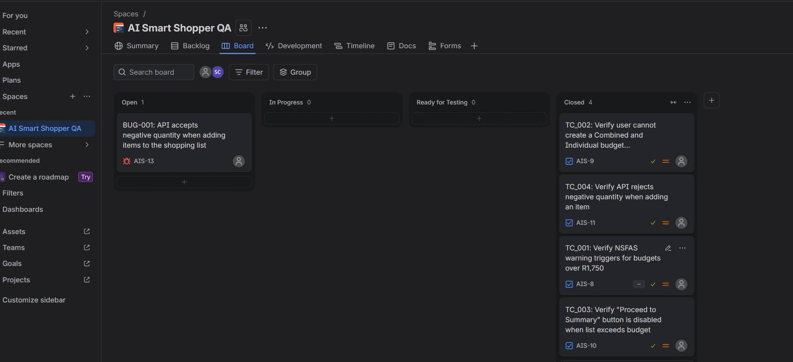
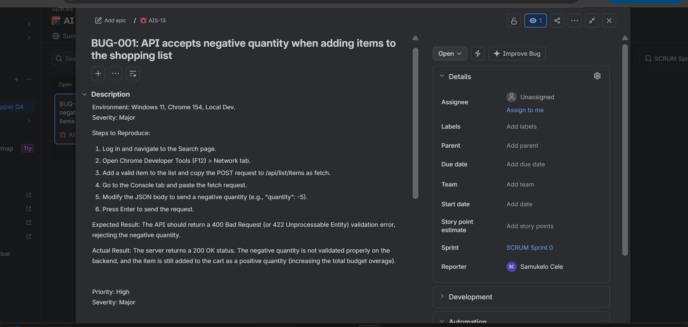
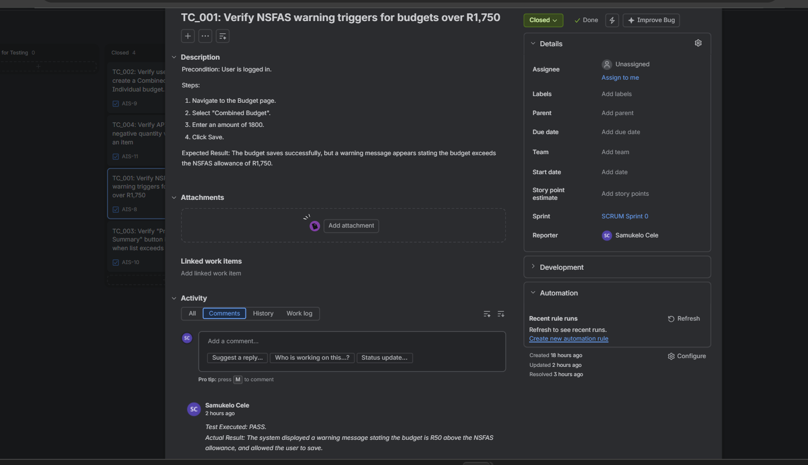
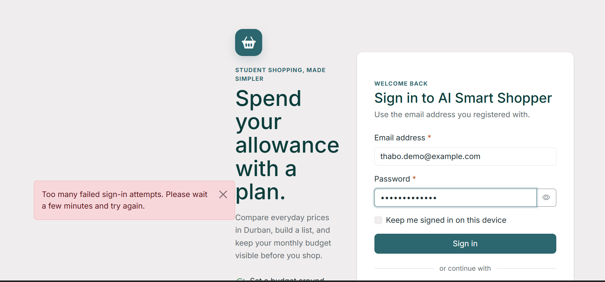

# 🛒 QA Portfolio: AI Smart Shopper Testing
**Tester:** Samukelo Cele
**Project Type:** Manual Functional, API, & Security Testing
**Application Under Test:** AI Smart Shopper (Flask Web App)

## 📝 Project Overview
AI Smart Shopper is a budgeting and price-comparison web application designed for NSFAS students. This project demonstrates a complete manual testing cycle, focusing on complex business logic, user authentication, and backend API vulnerabilities. 

## 📂 Documentation & Artifacts
Click the links below to view the detailed QA artifacts:
*   📋 **[View the Test Plan & Scope](./01_Test_Plan/Test_Plan.md)**
*   🧪 **[View the Executed Test Cases](./03_Test_Cases/Test_Cases.md)**

## 🎯 Test Strategy Summary
Testing was performed using a **Risk-Based Approach**. I focused on the core user journey and the highest-risk business logic (Authentication, Budget Rules, Over-budget locking, and API security).

## 🐛 Defect Management (Jira)
Defects were logged in Jira with detailed steps to reproduce, expected vs. actual results, and severity/priority. 

### Jira Board Overview
*Shows Test Cases executed (Closed) and the active Bug found (Open).*

### Example Bug Report
*Found during API testing: The backend accepts negative quantities.*

## 🧪 Test Execution Evidence
Test cases were executed and documented directly in Jira. Below is an example of a passed test case with the actual result logged.

## 🔐 Security & Rate Limiting
During authentication testing, the system's rate-limiting mechanism was validated. After multiple rapid failed login attempts, the system successfully protected itself against brute-force attacks.

